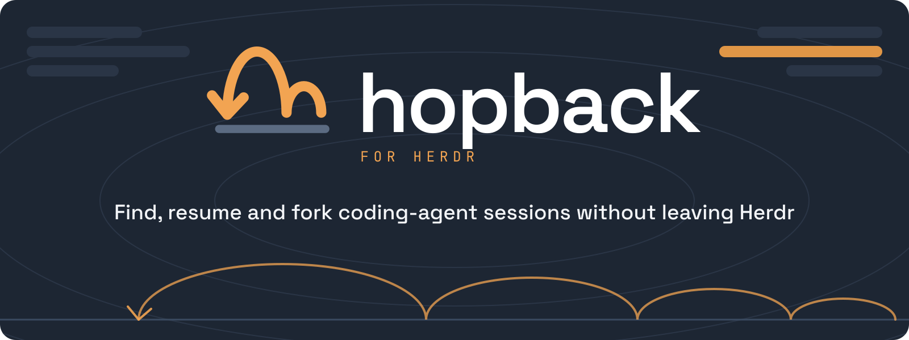

<br />
<p align="center">
  
</p>

<h3><p align="center">Hop back into any coding-agent session, right inside Herdr</p></h3>

<h4><p align="center">
<a href="#install">[Install]</a>
- <a href="#what-you-get">[Features]</a>
- <a href="#keys">[Keys]</a>
- <a href="https://github.com/avgvi/hopback">[hopback]</a>
- <a href="RECIPE.md">[Recipe]</a>
</p></h4>

<p align="center">
  <a href="https://herdr.dev/mods/avgvi/herdr-hopback"></a>
  <a href="https://github.com/avgvi/hopback"></a>
  
  <a href="LICENSE"></a>
</p>
<br />

Press **Cmd+Shift+R** and every session you ever ran with Claude Code, Codex, Antigravity, OpenCode, Pi and [the rest](https://github.com/avgvi/hopback#supported-agents) is in one list. Type a few letters, press Enter, and the agent is back in a new tab of the right space, mid-conversation.

https://github.com/user-attachments/assets/92995d54-86fe-4426-9360-b1009021329f

## What you get

| | |
|---|---|
| **Every agent, one list** | Search titles, messages and folders across all your agents. `agent:codex`, `dir:api` and `date:<2d` narrow it down. |
| **Resume in the right place** | Enter opens the session with its own agent, in a new tab of the space that holds its folder, or in a new space. |
| **Never open it twice** | A session already running in Herdr is marked `open`, and Enter takes you to its tab. |
| **Fork across agents** | Ctrl+F forks a session in the same agent, or turns a Claude Code session into a Codex one and back, with the whole conversation. |
| **A list you curate** | Pin what matters, rename what's unclear, hide what's done. |
| **Continue here** | Cmd+Shift+. reopens the newest session of the folder you're in, no list at all. |

## Install

1. Install [hopback](https://github.com/avgvi/hopback#install) 0.2.0 or later, whichever way you prefer:

   ```sh
   brew install avgvi/tap/hopback
   ```

   ```sh
   npm install -g hopback-tui
   ```

   ```sh
   uv tool install hopback
   ```

2. Ask your Herdr agent to add `herdr.dev/mods/avgvi/herdr-hopback`. Or copy `mods/hopback/` and `mods/hopback-continue/` into `~/.config/herdr-app/mods/` and merge `keys.json` into yours.

## Keys

| Anywhere in Herdr | |
|---|---|
| Cmd+Shift+R | Open the list |
| Cmd+Shift+. | Continue the newest session of this folder |

| In the list | |
|---|---|
| ↑ ↓, Enter | Resume, or go to its tab when it's open |
| Tab, Shift+Tab | Next or previous agent |
| Ctrl+S | This space's folder only, or everywhere |
| Ctrl+T | Pin or unpin |
| Ctrl+R | Rename |
| Ctrl+F | Fork |
| Ctrl+Y | Copy the resume command |
| Ctrl+X | Hide |
| Ctrl+O | All of the above, in a menu |
| Esc | Close |

The keys work only while the list is open, and they're the same as in the `hb` terminal app. The last item of the Ctrl+O menu sets whether agents start with their skip-permissions flag.

## What it runs

The mod runs `hb` for every search and change. Pins, titles and hidden sessions live in hopback's own data; a fork creates a new Claude Code or Codex session.

## Update

Herdr doesn't update mods from others: copy both folders over the old ones, then run `herdr-app check` on each.

## License

MIT
