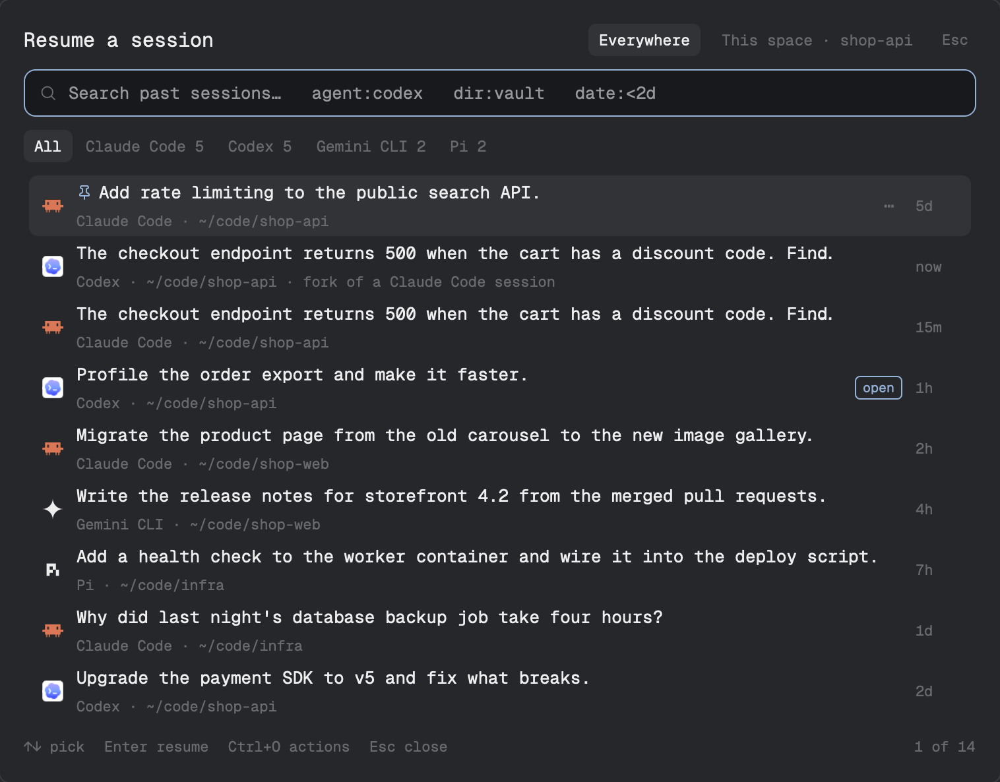

# hopback for Herdr

A pop-up that searches every past coding-agent session on this computer and reopens one in a new tab of the space that holds its folder. From the same list you pin, rename, hide, copy and fork sessions. A second key reopens the newest session of the folder you're in without showing the pop-up. Both run on hopback (`hb`).

## What you see

**The pop-up** (`hopback`): 760 px wide, up to 75% of the window tall, 40 px below the top edge, background `popover`, 18 px padding, 10 px between rows. Top to bottom:

1. **Header.** "Resume a session" (15 px, semibold, `foreground`) on the left. On the right, small chips (11.5 px, 8×3 px padding, 6 px radius): "Showing hidden ✕" while hidden sessions are shown, "Everywhere", "This space · <space name>", then "Esc". The selected chip has `hover` behind it and `foreground` text; the others are `dim`.
2. **Search box.** 36 px tall, 9 px radius, 1 px `accent` border, `background` fill, a 15 px `search.svg` in `dim`, then the input (12.8 px). Placeholder: `Search past sessions…   agent:codex   dir:vault   date:<2d`.
3. **Agent tabs.** Chips in the header's style: "All", then each agent hopback has sessions for with its count, most first ("Codex 629", "Claude Code 174"…). Only shown when there are two or more agents.
4. **List.** Exactly 9 rows of 46 px. A row: the agent's icon (16 px, from `knownAgents()`, a `border`-colored square when unknown), then two lines: the title (13 px, `foreground`, `dim` when hidden; a 12 px `accent` `pin.svg` before it when pinned) and "Agent · ~/folder" (11 px, `dim`; "· fork of a Claude Code session" added for forks). On the right: a "hidden" badge (`dim`) and an "open" badge (`accent`; 10 px text, 1 px border, 4 px radius) when they apply, "⋯" on the selected row, and the age ("now", "5m", "3h", "2d", "4mo", "1y") in a 32 px column. The selected row has `hover` behind it, 7 px radius.
5. **Footer.** 11 px, `dim`: key hints on the left ("↑↓ pick", "Enter resume" or "Enter go to tab", "Ctrl+O actions", "Esc close"), then, on the right, a passing message in `foreground` (`blocked` for errors), or in `blocked` "starts without permission prompts" when the selected session's resume command has a skip-permissions flag, then "3 of 60 (175 match)".

The list area also shows, in its place:

- **Actions menu** (Ctrl+O or "⋯"): the session's title (12 px, `dim`), then 32 px rows with the action on the left and its key on the right: Resume or Go to its tab (Enter), Fork… (Ctrl+F), Pin to the top or Unpin (Ctrl+T), Rename (Ctrl+R), Copy the resume command (Ctrl+Y), Hide from hopback or Unhide (Ctrl+X), Search only this space or Search everywhere (Ctrl+S), Next agent (Tab), Show hidden sessions or Stop showing them, and "Permission prompts: <current>…".
- **Fork choices** (Ctrl+F): `Fork “<title>”`, then 46 px rows with a second line: "Fork in <agent>" (A new <agent> session that starts from this one's history) for agents with their own fork, and, for Claude Code and Codex sessions, "Fork to Codex" or "Fork to Claude Code" (Copies the conversation into a new … session), keyed 1 and 2. When the session can't be forked, hopback's reason in `blocked`.
- **Permission prompts**: "When hopback starts an agent (also for hb in the terminal)", then Ask first, Skip permission prompts, Keep each session's own mode, each with a second line; the stored one says "current".
- **Rename**: the selected row's title becomes a text box (20 px, `accent` border) filled with the current title.

**Quick continue** (`hopback-continue`): a 380×44 px pill at the top (no frame; 9 px radius, `border` outline, `popover` fill), "Finding the newest session here…" in 12.5 px `dim`. It closes as soon as the session opens. A toast says "Nothing to continue here" when the folder and the folders above it have no session, or "Continued from a folder above" when it used one of those.

## How it behaves

- It shows no agent statuses. "open" marks a session that an agent is running in a Herdr terminal right now.
- **Typing** searches 140 ms after the last key. The first search after opening refreshes hopback's index; later ones read it as it is. hopback returns at most 60 sessions per search; the count shows how many matched in all.
- **↑ ↓, Page Up, Page Down** move the selection, and the list scrolls to keep it in view. The mouse wheel scrolls by rows.
- **Enter or a click on a row**: when the session is open in a Herdr terminal, its space, tab and pane come to the front. Otherwise its resume command starts in a new tab named after the session, in the space whose folder holds the session's folder (the longest match), or in a new space when none does. A session whose folder is gone shows a warning toast instead. The pop-up closes.
- **Tab, Shift+Tab** and clicks on agent chips switch the agent; **Ctrl+S** and the scope chips switch between everywhere and the shown space's folder.
- **Ctrl+T, Ctrl+R (or F2), Ctrl+X, Ctrl+Y** act on the selected session, show a message in the footer for 3.5 s and reload the list on the same session. Rename: Enter saves, an empty title goes back to the agent's own, Ctrl+R cancels.
- **Ctrl+F** asks hopback which forks are possible (dry runs), then Enter, 1 or 2, or a click creates the fork and opens it in a new tab named "<title> (fork)" or "<title> (fork → Codex)".
- **Ctrl+O** or "⋯" opens the menu; Ctrl+O again or typing returns to the list. Ctrl+F leaves the fork choices the same way.
- **Clicking the red footer note**, or the menu's last item, opens the permission choice; Enter, 1–3 or a click stores it in hopback and reloads the list, since resume commands change with it.
- **Esc** closes the pop-up from anywhere in it. Closed, every key goes back to what it did before.
- **Cmd+Shift+.** uses the focused terminal's folder, else the shown space's folder, else the home folder.

## Built from

- `mods/hopback/` (`main.js`, `lib.js`, `mod.json` with `"place": "none"` and a `popup` overlay at `top`) and `mods/hopback-continue/` (`main.js`, `lib.js`, a 380×44 `popup` with `"frame": "none"`). `lib.js` is the same file in both: the finding and running of `hb`, the folder-to-space match, the open-session check and the openers.
- `keys.json`: `global` `cmd-shift-r` → `mod.open:hopback`, `cmd-shift-.` → `mod.open:hopback-continue`.
- gpui-kit `View`, `div`, `svg`, `image`; gpui-base `v_flex`, `h_flex`, `InputState`, `Input`. Icons: Herdr's `mods/workspace-chrome/search.svg` and `pin.svg`.
- `herdr`: `exec`, `run` (`space.select`, `space.new`, `tab.new`, `tab.select`, `pane.focus`), `spaces`, `panes`, `terminals`, `focused`, `knownAgents`, `home`, `theme`, `notify`, `props`, `closeOverlay`.
- Programs: `test -d` for the folder check, and `hb`:
  - `hb --json --limit 60 [--no-refresh] [--include-hidden] [-a <agent>] [-d <folder>] -- <query>`
  - `hb --json --all --no-refresh` once, for the agent counts
  - `hb pin|unpin|hide|unhide --json --no-refresh -- <agent:id>`
  - `hb rename --json --no-refresh [--reset] -- <agent:id> [title]`
  - `hb fork --json [--dry-run] --no-refresh [--to codex|claude] -- <agent:id>`, then the answer's `launch_command`
  - `hb config permission get` and `hb config permission set normal|yolo|inherit`
  - `hb . --print` with the folder as working directory (quick continue), then `hb --json --all --no-refresh -d <folder>` to get that session's command as a list

## Watch out

- Herdr closes a popup on Esc before the mod sees the key, so Esc can't step back out of a panel. Each panel ends with its own key pressed again.
- Herdr starts programs with herdr-core's `PATH`, which often lacks `~/.cargo/bin`. `lib.js` tries `hb`, then the folders Cargo, Homebrew (both prefixes and Linuxbrew), uv and pipx, mise and Nix install into. It needs `hb --version` 0.2.0 or later, says so when it finds an older one, and looks again when a run fails to start.
- A mod can't import from another mod's folder (`herdr-app check` reports it), hence the two copies of `lib.js`.
- Put `"--"` before the query and before selectors: a search for "fork" or "pin" is otherwise read as one of hb's commands, and a title starting with "-" as a flag.
- Use resume and launch commands as the lists hopback returns; never split shell text. Codex gets `--no-daemon` after `codex`, as Herdr starts it.
- A terminal's `argv` is the shell wrapper (`/bin/zsh -lic … <command>`), and the shell stays after the agent quits. "Open" means the session id is in `foreground.argv` (the program in front), or in `argv` while the `program` in front isn't the shell. A native Claude Code fork's command names the parent after `--resume`; that one doesn't count as open there.
- Clicking a non-focusable element (the footer note, "⋯") takes the keyboard from the search box; give it back when a panel opens.
- Digits pick fork and permission choices; they don't reach the search box while a panel is open.
- `herdr-app check` runs `init` once with no terminals and no spaces.
- Write `mod.json` before `main.js` when creating a mod folder in a running Herdr, or the mod can land in the shown layout as a block.

## Done when

- Cmd+Shift+R opens the pop-up with the 9 newest sessions, agent chips with counts and "1 of 60 (N match)".
- Typing `agent:codex` lists only Codex sessions; Tab moves through the agent chips; Ctrl+S with a space shown lists only sessions under its folder.
- Ctrl+T shows a pin before the title and "Pinned to the top"; again, "Unpinned". `hb --json` agrees each time.
- Ctrl+R, a new title and Enter rename it; Ctrl+R, an emptied box and Enter bring back the agent's title.
- Ctrl+X hides the session; Ctrl+O → Show hidden sessions shows it dimmed with "hidden"; Ctrl+X there unhides it.
- Ctrl+F on a Claude Code session offers both forks; on an Antigravity session it shows hopback's reason.
- With a session's agent running in a Herdr terminal, its row says "open" and Enter brings that tab forward instead of opening another.
- Enter on a session that isn't open starts its agent in a new tab named after it, in the space for its folder.
- Clicking "starts without permission prompts" opens the permission choice; picking Ask first makes `hb config permission get` print `always_normal`, and the note disappears.
- Cmd+Shift+. in a folder with no sessions above it shows "Nothing to continue here" and opens nothing.
- With `hb` missing, the pop-up says how to install it.
